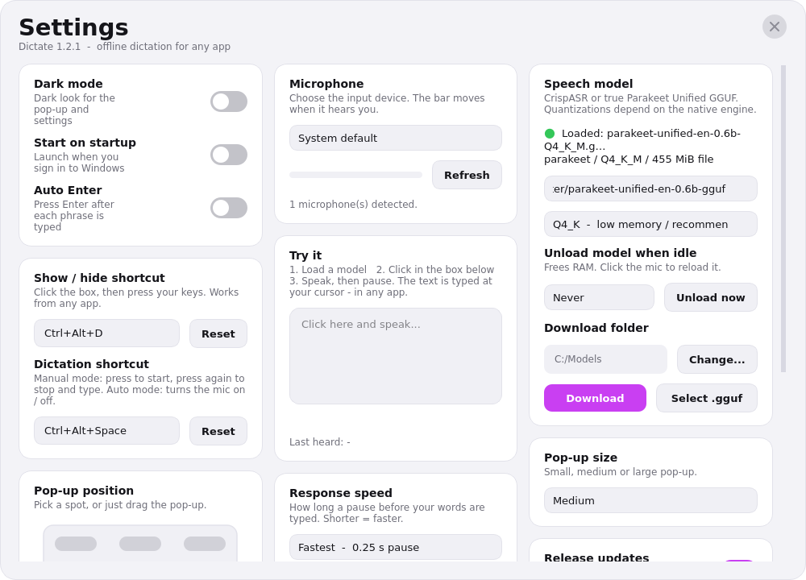

<p align="center">
  
</p>
<h1 align="center">Dictate</h1>
<p align="center"><strong>Your voice. Your words. Your computer.</strong></p>
<p align="center">Fast, offline dictation for Windows, powered by NVIDIA Parakeet.</p>
<p align="center">
  <a href="https://github.com/Comet-Suite/dictate-desktop/releases/latest"></a>
  <a href="LICENSE"></a>
  <a href="https://github.com/Comet-Suite/dictate-desktop/actions/workflows/windows-release.yml"></a>
</p>

---

Dictate turns speech into text in the application you are already using. Click into a text box, start a recording, speak naturally, and stop when you are done. Your complete message is inserted in one operation—not a stream of simulated keystrokes.

**Audio stays on your computer. No dictation account or cloud transcription service is required.**

## Why Dictate

- **Local speech recognition.** True Parakeet Unified English 0.6B support alongside compatible CrispASR GGUF models.
- **Less waiting after long recordings.** Background transcription processes speech while you speak. Nothing is inserted before you stop.
- **Smooth, complete insertion.** One bulk paste per recording, with an optional single Enter. Pauses never submit your shortcut recording.
- **Natural amounts and symbols.** Say “four hundred dollars” or “400 rupees”; get `$400` or `₹400`. Percentages, numeric expressions, spoken email addresses, and 167 explicit symbols are supported.
- **Two independent global shortcuts.** One controls pop-up visibility; the other starts and commits dictation.
- **A compact desktop companion.** Moveable pop-up, microphone meter, light/dark settings, model downloads, and idle unloading.

<p align="center"></p>

## Install on Windows

1. Open the **[latest release](https://github.com/Comet-Suite/dictate-desktop/releases/latest)**.
2. Download `Dictate-Setup-1.2.0-x64.exe` and run it.
3. Open **Dictate** from the Start menu.
4. In **Settings → Speech model**, download a supported model or select a compatible `.gguf` file.
5. Wait for the model to load, then click into the text box where you want your words.

The installer includes Python and both speech runtimes. **You do not need to install Python separately.** Model weights are downloaded separately and are not included in the installer.

> **Windows security notice:** the installer is not code-signed. SmartScreen may show a warning. Verify the download against `SHA256SUMS.txt` in the release, and only run downloads you trust.

**System:** Windows 10/11, 64-bit x86 processor and a microphone. At least 8 GB RAM is recommended; larger models and quantizations need more memory. Internet access is required for initial model downloads, not for local transcription afterwards.

A portable ZIP is also provided. Extract the entire archive before running `Dictate.exe`; do not move the executable out of its folder.

## Start with Windows

Enable **Settings → Start on startup**. Dictate will start automatically when **your Windows account signs in**. This remains opt-in; an existing disabled preference is not changed.

The app checks its saved startup preference on a manual launch. The installer also repairs missing or outdated startup registration during a reinstall or upgrade, even with silent installation. Paths containing spaces are quoted, and the installed executable—not an internal Python file—is registered.

If Windows still prevents startup, check **Windows Settings → Apps → Startup → Dictate** (or Task Manager → Startup apps) and enable it there. Dictate does not bypass Windows startup-app restrictions or administrator policies. Windows can delay startup applications while sign-in completes.

To apply the corrected **1.2.0** installer over an existing installation, quit Dictate from its tray menu and rerun the installer. Keep your existing **Start on startup** preference enabled. Your settings and model files are retained.

## Record, pause, finish

| Shortcut | Default | Action |
|---|---|---|
| Show / hide | `Ctrl` + `Alt` + `D` | Toggle the floating pop-up |
| Dictation | `Ctrl` + `Alt` + `Space` | First press: record. Second press: insert the complete recording. |

Both shortcuts are configurable in Settings. Existing two-shortcut settings are preserved. If you used the single-shortcut build, its recording key is retained and the default show/hide key is restored.

1. Put the cursor in the destination text box.
2. Press the **dictation shortcut**.
3. Speak for as long as you need. You can pause without sending anything.
4. Press the same shortcut again.
5. Dictate inserts the assembled text once. **Auto Enter**, if enabled, sends Enter once afterwards.

The microphone and pause controls remain available in the pop-up. Automatic microphone mode is separate from explicit shortcut recordings.

## Speak naturally

| Say | Result |
|---|---|
| four hundred dollars | `$400` |
| 400 rupees | `₹400` |
| four hundred rupees and fifty paise | `₹400.50` |
| fifty percent | `50%` |
| two plus two equals four | `2 + 2 = 4` |
| john dot smith at example dot com | `john.smith@example.com` |
| at sign, hash sign, dollar sign | `@#$` |

Natural transformations use context rather than blindly changing every “at”, “plus”, or currency word in normal prose. Recognition still depends on the selected model and microphone. The full explicit symbol vocabulary is in [`docs/SYMBOLS.md`](docs/SYMBOLS.md).

## Choose a model

| Model family | Runtime | Recommended repository |
|---|---|---|
| **Parakeet Unified English 0.6B** | transcribe.cpp | [`handy-computer/parakeet-unified-en-0.6b-gguf`](https://huggingface.co/handy-computer/parakeet-unified-en-0.6b-gguf) |
| **Parakeet TDT 0.6B v3** | CrispASR | [`cstr/parakeet-tdt-0.6b-v3-GGUF`](https://huggingface.co/cstr/parakeet-tdt-0.6b-v3-GGUF) |

For Unified, `Q4_K_M` is a good low-memory starting point. Larger quantizations use more memory. Dictate inspects GGUF metadata to select the matching runtime; renaming an incompatible file will not convert it.

Model weights have their own licenses. Read the selected model's license before use or redistribution.

## Privacy and local data

- Audio is buffered in memory and is not saved as recording files by Dictate.
- Speech recognition runs locally; Dictate does not send audio to a transcription API.
- Preferences are stored in `%APPDATA%\Dictate\settings.json`.
- Downloaded models stay in your chosen download folder.
- Text is temporarily placed on the system clipboard for bulk insertion. The previous clipboard is restored when possible, unless you copy something else. **Windows clipboard history or clipboard sync may retain text according to your Windows settings.**
- Error diagnostics, if needed, are written to `%APPDATA%\Dictate\error.log`.

## Run from source

Python 3.12 is used for the Windows release.

```powershell
git clone https://github.com/Comet-Suite/dictate-desktop.git
cd dictate-desktop
py -3.12 -m venv .venv
.\.venv\Scripts\Activate.ps1
python -m pip install -r requirements.txt
pythonw dictate.py
```

The application source remains a **single Python file**. Its logo is embedded, so running `dictate.py` does not require a separate image path.

## Build and verify

```powershell
python -m pip install -r requirements-build.txt
powershell -ExecutionPolicy Bypass -File packaging\build.ps1 -Version 1.2.0
```

See **[Windows build instructions](docs/BUILDING.md)** for Inno Setup prerequisites, smoke tests, dependency notices, and release verification. Tagged releases are built on Windows through GitHub Actions, tested after installation, and published with checksums.

Development checks:

```powershell
python -m pip install -r requirements-dev.txt
python -m pytest -q
python -m ruff check dictate.py --select F,E9
```

Native runtime compatibility and application behavior are tested separately. Physical microphones, keyboard layouts, elevated applications, and third-party text controls can behave differently across systems.

## Troubleshooting

- **The updated app does not open:** quit the running copy from its tray menu first. Dictate prevents duplicate instances.
- **The microphone is quiet:** select the correct input device and verify the level meter in Settings.
- **A shortcut does not work:** choose an unused combination; another app may already own it.
- **Text does not paste into a protected application:** test with a normal text editor. Elevated or clipboard-restricted apps may need special permissions or may reject simulated input.
- **The old icon remains pinned:** unpin the old shortcut, launch the installed `Dictate.exe`, and pin that instance again. Windows can cache icons from older shortcuts.
- **Recognition is slow:** try a smaller quantization, keep the model loaded, and reduce competing CPU workloads. Background transcription reduces the post-stop wait but cannot make every model real-time on every processor.

Found a bug? **[Open an issue](https://github.com/Comet-Suite/dictate-desktop/issues/new/choose)** with your Windows version, model, quantization and steps to reproduce. Do not attach tokens, private transcripts or sensitive audio.

## License

Dictate is distributed under **[GNU GPL version 3](LICENSE)**. Bundled dependencies retain their respective licenses; see [`THIRD_PARTY_NOTICES.md`](THIRD_PARTY_NOTICES.md) and the license files included in each Windows package. Model weights are not part of this repository or its installer.
